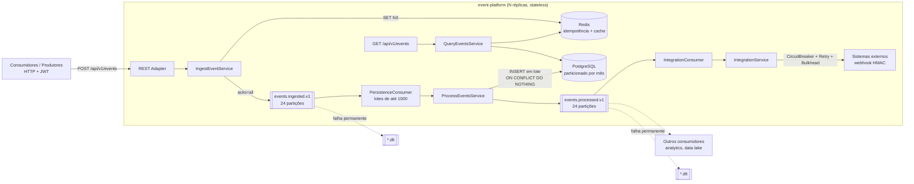

# Arquitetura

## 1. Visão geral

A plataforma separa o **caminho crítico de latência** (receber e registrar o evento de forma durável)
do **trabalho pesado** (persistir, indexar, integrar). O Kafka é a fronteira entre os dois: absorve picos,
desacopla taxas de produção e consumo e serve como fonte de verdade reprocessável.



### Fluxo de um evento

1. **Ingestão (síncrona, ~5–20 ms)**: valida o payload, deriva o id (UUIDv7 ou determinístico a partir de
   `Idempotency-Key`), checa duplicidade no Redis (`SET NX`) e publica no Kafka com `acks=all`.
   Responde **202** só depois da confirmação do broker — o evento nunca é perdido depois de aceito.
2. **Persistência (assíncrona)**: consumidores em lote gravam no PostgreSQL com `INSERT ... ON CONFLICT DO NOTHING`
   em uma única transação por lote e republicam em `events.processed.v1`.
3. **Integração (assíncrona, isolada)**: grupo de consumo próprio entrega a sistemas externos com
   resiliência; lentidão externa gera *lag* apenas nesse grupo.
4. **Consulta**: leitura por id via cache Redis (eventos persistidos são imutáveis) e listagem por tenant
   com paginação *keyset*.

## 2. Arquitetura hexagonal

```
com.example.eventplatform
├── domain            ← modelo + portas (Java puro, sem framework)
│   ├── model         Event, EventIds (UUIDv7), EventQuery, EventPage
│   └── port
│       ├── in        IngestEventUseCase, ProcessEventsUseCase, QueryEventsUseCase
│       └── out       EventLogPublisher, EventRepository, IdempotencyStore, DownstreamNotifier
├── application       ← casos de uso (Java puro)
├── adapter
│   ├── in.rest       Controller, DTOs, Problem Details
│   ├── in.kafka      PersistenceConsumer, IntegrationConsumer
│   └── out           kafka, persistence (JDBC), cache (Redis), integration (HTTP)
├── config            composição (único lugar que conhece ambos os lados)
└── observability     filtros, health indicators
```

As regras são verificadas a cada build pelo `ArchitectureTest` (ArchUnit): o núcleo não pode depender de
Spring, Kafka, Jackson ou Micrometer. Isso permite trocar Kafka por Pulsar/Kinesis, ou JDBC por outro
armazenamento, implementando apenas um adapter.

## 3. Garantias de entrega

| Etapa | Garantia | Mecanismo |
|---|---|---|
| Cliente → API | pelo-menos-uma-vez (cliente reenvia em 503/timeout) | `Idempotency-Key` → id determinístico |
| API → Kafka | durável após 202 | `acks=all`, `min.insync.replicas=2`, produtor idempotente |
| Kafka → PostgreSQL | efetivamente-uma-vez | offset confirmado após commit; PK `(id, occurred_at)` + `ON CONFLICT DO NOTHING` |
| Kafka → sistemas externos | pelo-menos-uma-vez | header `Idempotency-Key` para deduplicação no receptor |

Deduplicação em duas camadas: o Redis responde rápido a reenvios com `Idempotency-Key` (TTL de 6 h) e **falha aberto**;
o banco é a garantia final. Indisponibilidade do Redis degrada a detecção de duplicatas na API,
nunca a ingestão nem a correção dos dados.

## 4. Por que esse desenho atende 5k–20k ev/s com p95 < 200 ms

- **O banco está fora do caminho crítico.** A latência da API é dominada por uma ida ao Redis (~0,3 ms)
  e uma escrita no Kafka (`linger.ms=5` + replicação, tipicamente 5–15 ms). Picos não pressionam o PostgreSQL:
  o Kafka acumula e os consumidores drenam no ritmo sustentável.
- **Threads virtuais (Java 21)**: cada requisição bloqueia esperando o ack do broker sem consumir uma thread
  de plataforma — milhares de requisições concorrentes por pod com pouca memória.
- **Escrita em lote**: até 1.000 registros por `poll`, `reWriteBatchedInserts=true` (INSERT multi-linha) e um
  commit por lote. 20k ev/s viram ~20–40 transações/s por consumidor.
- **Particionamento** (Kafka e PostgreSQL) para paralelismo horizontal e índices que cabem em memória.
- **Sem estado no pod**: escala horizontal pelo HPA; partições definem o teto de consumidores (24).
- **ZGC geracional** e **sem CPU limit** no Kubernetes: pausas de GC sub-milissegundo e sem *throttling* do CFS,
  os dois maiores vilões de cauda de latência em JVMs conteinerizadas.

Detalhes numéricos em [capacity-planning.md](capacity-planning.md).

## 5. Segurança

- **AuthN/AuthZ**: OAuth2 Resource Server (JWT). Escopos `events:write` / `events:read`. Chaves públicas via
  JWKS do IdP (rotação sem deploy). Validação de `aud`.
- **Multi-tenancy**: `tenant_id` vem **somente** do token assinado. Leitura de evento de outro tenant retorna 404
  (não revela existência).
- **Entrada**: Bean Validation, limite de payload (64 KiB/evento, 4 MiB/requisição), regex no tipo,
  rejeição de `occurredAt` no futuro, `X-Correlation-Id` sanitizado contra *log forging*.
- **Saída para terceiros**: webhook assinado com HMAC-SHA256 (`X-Signature`), timeouts explícitos.
- **Plataforma**: container não-root, FS somente leitura, `capabilities: drop ALL`, NetworkPolicy,
  Actuator em porta interna, Swagger desligado em produção, segredos fora do repositório.
- **Erros**: RFC 9457 (Problem Details) sem stack trace ou mensagens internas em 5xx.

## 6. Observabilidade

| Sinal | Ferramenta | Destaques |
|---|---|---|
| Métricas | Micrometer → Prometheus | histogramas com SLO (50/100/200/500 ms), `events_ingested_total{outcome}`, `events_persistence_batch_duration`, lag dos consumidores, estado do circuit breaker, Hikari |
| Tracing | Micrometer Tracing → OpenTelemetry (OTLP) | propagação HTTP → Kafka → consumidores (observation habilitada no template e nos listeners), amostragem configurável |
| Logs | JSON (ECS) estruturado | `traceId`, `spanId`, `correlationId` em cada linha |
| Saúde | Actuator probes | readiness depende só do Kafka (ver ADR-0003) |
| Alertas | `observability/alerts.yml` | p95 > 200 ms, erro 5xx > 1 %, lag, DLT, circuit aberto, Redis fail-open |

### SLOs

| SLO | Objetivo | Janela |
|---|---|---|
| Latência de ingestão p95 | < 200 ms | 30 dias |
| Disponibilidade da ingestão (não-5xx) | 99,9 % | 30 dias |
| Frescor (evento consultável após aceito) p95 | < 5 s em regime normal | 30 dias |

## 7. Evolução sustentável

- **Contratos versionados**: tópicos com sufixo `.v1`; mensagem com `schemaVersion`. Próximo passo natural:
  Schema Registry (Avro/Protobuf) com verificação de compatibilidade no CI (ADR-0004).
- **API versionada** (`/api/v1`), OpenAPI gerado do código.
- **Novos consumidores** assinam `events.processed.v1` sem tocar a plataforma (fan-out).
- **Retenção**: partições mensais permitem `DETACH/DROP PARTITION` ou mover para armazenamento frio.
- **Qualidade**: ArchUnit, testes unitários do núcleo sem infraestrutura, testes de integração com
  Testcontainers, cobertura JaCoCo, teste de carga k6 com thresholds que reprovam o pipeline.

Decisões registradas em [`docs/adr`](adr).
